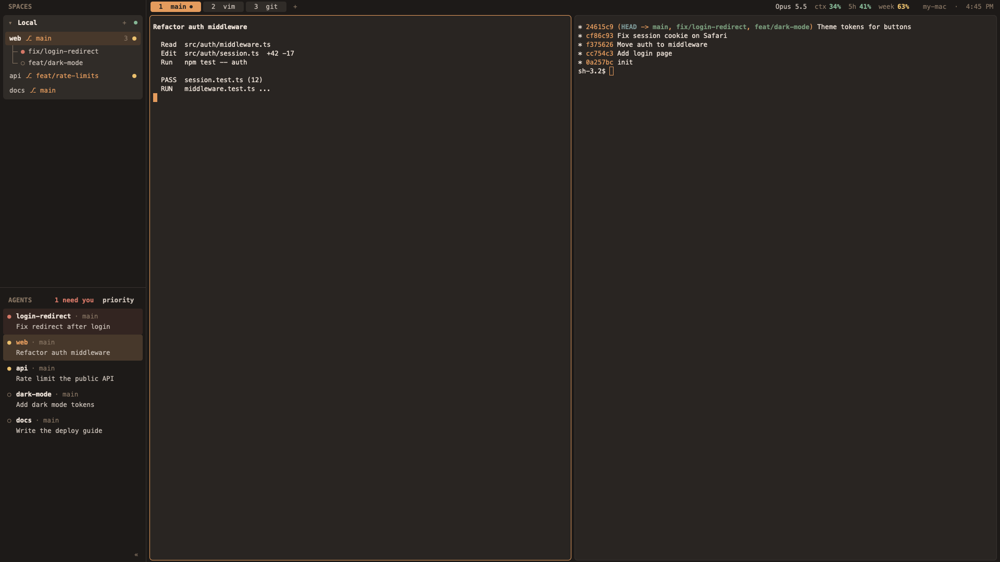

# herdr-tui-layout

**herdr-tui's look and keys, inside herdr-app.**
Spaces by machine with their branches and worktrees, your agents under them,
a slim bar of tab segments over the panes, and the `ctrl-b` keys your hands
already know.




A community layout for the [Herdr](https://herdr.dev) desktop app
(**herdr-app**). It is not herdr-tui, the terminal app, and it is not made by
Herdr.

- **The sidebar you're used to.** One rounded block per machine (`Local`,
  your SSH machines), each space on one line with its branch in orange
  (`web ⎇ main`), worktrees drawn as a little tree under their repo
  (fold them with `▾` at the right), and the tab count. Fold a machine with a click; drag spaces to
  reorder them.
- **Agents under the spaces,** the way herdr-tui lists them: a status mark,
  the space and tab, and what the agent is doing. Sort by `priority` (who
  needs you first) or by `spaces`, and drag the divider between the halves.
- **Tabs as a hairline.** A 2px line over the panes, in the border colour
  so it meshes with the border lines around it, divided once per tab of the
  shown space — no text, the shown tab's segment lit. Click a segment to go
  to that tab. Nothing there when the space has no tabs; new tabs come from
  `ctrl-b c` or the picker. Dragging the line moves the window.
- **The status line at the bottom.** Under the agents: the focused agent's
  model and context, your Claude 5-hour and weekly use with reset times on
  hover, and the machine and time, like herdr-tui's `tab_bar_right`. No top
  line: your panes get the whole height, and the sidebar drags the window.
- **`ctrl-b` keys.** New tab, split, zoom, move between panes, jump to a
  space or agent by number, new worktree, rename, the picker, and lazygit,
  btop and yazi in floating terminals.
- **Folds to a strip.** `«` turns the sidebar into a 40px rail of space
  numbers and agent letters with their status, `»` brings it back.
- **Machines that drop.** A remote machine shows green, `◐ reconnecting`, or
  red `unreachable`, and a folded machine still shows the most urgent agent
  inside it.
- **A hand-picked palette on warm grey** — soft sage main accent going
  around the panels, with mint, crimson, warm yellow, violet, blue and
  lilac supporting colours, brighter
  pastels for the thin bits (borders, dim text, idle marks), and Menlo at
  one size everywhere, terminals and panels alike. The wallpaper shows
  faintly through it all — the background is your own image, unmuted, and
  every surface mutes it itself: the sidebar cards and the terminals with
  the terminal surface at ~78%, the sidebar now floating as two rounded
  cards with a 1px border instead of a vertical separator.
- **A worktree dialog that sets you up.** New worktree asks the git branch
  and the base branch — suggestions from the repo's local and remote
  branches while you type (↑↓ move, tab picks), a remote base is fetched
  first, the branch name is validated and an already-checked-out branch or
  an existing folder is caught — and a startup script, picked from saved
  scripts or typed on the spot, that runs as the new space's first
  terminal (ported from the herdrtw layout).
- **Rounded popups that fit.** Right-click menus, rename, the worktree
  dialog, the picker and help draw their own rounded boxes, so their corners
  don't show the notch Herdr's stock dialogs have.
- **The wallpaper behind your text.** Terminal panes paint no card fill —
- **The wallpaper behind your text.** Terminal panes paint no card fill —
  the image sits directly under the terminal — and the terminal surface
  paints over it at ~78% (`terminal_opacity: 0.68`), so the washes come
  through faintly. Adjust with one number (`terminal_opacity` in the
  layout file).
## Try it in two minutes

You need:

- **herdr-app** (the Herdr desktop app) 0.1.12 or newer, with herdr-core
  (`hc`). Built and tested on macOS 27 with herdr-app 0.1.12 and hc 0.1.17.
- Optional: lazygit, btop and yazi for the popup keys; Claude Code for the
  usage numbers.

### The easy way: ask your agent

In a Herdr terminal, ask your coding agent:

> Add the layout herdr.dev/layouts/VedangP57/herdr-tui-layout

Herdr's agent guide (`~/.config/herdr-app/AGENTS.md`) tells it how: read every
file, copy the layout, mods and theme into place, merge `keys.json`, check
each mod and switch to it.

### The script way

```sh
git clone https://github.com/VedangP57/herdr-tui-layout.git
cd herdr-tui-layout
./scripts/install.sh               # add --usage-hook for the Claude numbers
```

It copies `layouts/`, `themes/` and `mods/` into `~/.config/herdr-app`
(or `$HERDR_APP_HOME`), adds the layout's keys to `keys.json`, runs
`herdr-app check` on every mod, and switches to the layout. The toplevel
`./install.sh` then trims `keys.json` to parity: Herdr's stock bindings for
commands the `ctrl-b` keys provide are dropped (one way each), and — only
if the herdr-nvim mod is installed — herdr-nvim's `cmd-` keys get `alt-`
twins for Linux, where the `cmd-` ones never fire (the table is
`scripts/keys-parity.json`, and the same step fixes an older install's dead
`ctrl-b minus`). It never
overwrites anything without `--force`, and `--force` moves the old copy to
`~/.config/herdr-app/backups/` first. `keys.json` is backed up there too.

**Switch back any time** with `ctrl-shift-l`, or in Settings → Look.

## Keys

All on the `ctrl-b` prefix, and only while this layout is showing
(`keys.json`, section `layout:herdr-tui-layout`):

| Keys | Does |
|---|---|
| `c` · `n` · `p` | new tab · next tab · previous tab |
| `shift-x` · `shift-t` | close tab · rename tab |
| `shift-1`…`shift-9` | space 1–9 |
| `alt-h` · `alt-l` | previous tab · next tab |
| `alt-left` · `alt-right` | focus the pane to the left · right |
| `alt-j` · `alt-k` | next space · previous space (sidebar order, wraps) |
| `up` · `down` | previous space · next space (same, on the prefix) |
| `left` · `right` | back · forward through your recent spaces (wraps at the ends) |
| `r` · `shift-w` | rename this space |
| `shift-n` · `shift-d` | new space · close space |
| `w` | space picker (spaces, worktrees nested under their repo; Enter or click goes there) |
| `shift-g` | new worktree of this space's repo |
| `shift-h` · `shift-j` · `shift-k` · `shift-l` | split left · down · up · right |
| `x` · `z` | close pane · zoom |
| `h` `j` `k` `l` | go to the pane left · down · up · right |
| `alt-1`…`alt-9` | the agent in that row |
| `b` · `shift-b` | hide the sidebar · fold it to the strip and back |
| `alt-g` · `alt-b` · `alt-f` | lazygit · btop · yazi, floating; closes when the program quits |
| `shift-/` · `s` | help · settings |

Herdr's own `cmd` keys keep working alongside.

## Mouse

- **Space:** click to show it; drag onto another space of the same machine
  to move it; right-click for Rename, New / Open / Remove worktree, Close.
- **Machine row:** click to fold or unfold; `+` starts a space there.
- **Tab segment:** click to go to that tab. The bar also drags the window
  (double-click maximizes); rename a tab with `ctrl-b shift-t`.
- **Agent row:** click to go to that agent.
- **Terminal:** right-click for split, zoom and close.
- **Sidebar's empty space:** drag to move the window; double-click
  maximizes.
- **`«` / `»`:** fold the sidebar to a strip and back.
- **`priority` / `spaces`:** switch how agents are sorted.

## The usage numbers (optional)

The agents half's bottom line can show `Opus 5.5  ctx 34%  5h 41%  week 63%`:
the focused agent's model and how full its context is, then your Claude
5-hour and weekly limits (green, yellow from 50%, red from 80%; hover for
when each resets).

Claude Code only shares those numbers with its **status-line command**, so
the layout ships one: `extras/claude-usage-hook.sh`. It saves the JSON Claude
Code hands it to `~/.local/state/herdr-tui-layout/claude/<session>.json` and
**prints nothing**, so Claude Code's own bottom bar doesn't change.

- `./scripts/install.sh --usage-hook` installs it and sets
  `"statusLine"` in `~/.claude/settings.json` (backed up first). If you
  already have a status line, it leaves yours alone and tells you.
- It applies to every Claude Code session on the machine, started after it
  is set.
- Without it, the status line simply leaves the numbers out.

## How herdr-tui maps onto herdr-app

| herdr-tui | herdr-tui-layout |
|---|---|
| workspaces | spaces, grouped by machine |
| `prefix` + keys | `ctrl-b` + the same letters |
| agents sidebar, `priority` | agents half of the sidebar, `priority` / `spaces` |
| tab bar (numbered tabs) | the 6px segmented bar over the panes |
| `tab_bar_right` hostname · time | the agents half's bottom line |
| worktree tree under a repo | the same, drawn |
| popup keys (lazygit …) | floating terminals on `alt-g/b/f` |
| agent-quota sidebar rows | the usage numbers in that bottom line |
| machines (`vps`, …) | one block per machine, with its connection state |

Not carried over: link handlers (clicking a file path in terminal output);
herdr-app doesn't let layouts make terminal text clickable.

## What it runs

The guide asks layouts to say this up front. herdr-tui-layout:

- runs `hostname -s` and `hc machine ls --json` (to name and check machines),
  `git rev-parse` in each space's folder every 15s (to nest worktrees) and `git` in the worktree dialog — creating a worktree also validates the branch, probes the checkout for a package manifest, and runs `git fetch` when the base branch names a remote — then `sh -c` (the startup script, as the new space's first terminal), `sh`, `ls` and `stat` over
  `~/.local/state/herdr-tui-layout/claude/` (the usage numbers), and
  lazygit, btop or yazi when you press their keys;
- reads only that usage folder and its own `mods/herdr-tui-layout-worktree/scripts.json`
  (saved startup scripts) outside its own folder;
- makes no HTTP requests; `git fetch` in the worktree dialog talks to the
  repo's remote, only when the base branch names one.

## Troubleshooting

- **A panel shows "This view could not be rendered".** Run
  `herdr-app check ~/.config/herdr-app/mods/<that mod>` and open an issue
  with its output.
- **The tabs look cut off at the bottom.** A dragged boundary is saved in
  `~/.config/herdr-app/layouts/.state/herdr-tui-layout.json` and beats the
  layout file. If an older install's state keeps a 26px top strip, run
  `herdr-app do layout.reset --name herdr-tui-layout` (it keeps the old file
  aside).
- **"Too many open files" when opening tabs.** herdr-core keeps every
  terminal open in one background process, and macOS's default 256-file
  limit allows about 80 terminals. Raise it with
  `sudo launchctl limit maxfiles 65536 200000`, then log out and back in.
- **The corners of the terminal right-click menu and the close-confirm
  dialog are Herdr's.** The app opens those itself, so the layout can't give
  them its own box.
- **Your keys do nothing.** They only apply while this layout is shown, and
  `ctrl-b` must reach the app, not a terminal program that grabs it first.

## Update and uninstall

- **Update:** `git pull`, then `./scripts/install.sh --force`.
- **Uninstall:** switch to another layout, then delete
  `layouts/herdr-tui-layout.json` and `.png`, `themes/herdr-tui-layout.json`,
  `backgrounds/herdr-tui-layout-bg.jpg`, the `mods/herdr-tui-layout-*`
  folders and the `layout:herdr-tui-layout` section of `keys.json` in
  `~/.config/herdr-app`. If you installed the usage hook, remove
  `statusLine` from `~/.claude/settings.json`.

## Known limits

- Tested on Linux and macOS. Popup and picker sizes are shares of the
  window, so they follow its shape.
- Not yet tried on screen: the `ctrl-b` keys, the popups, help and the
  reconnecting state. Each loads and type-checks; reports welcome.
- `ctrl-b` is taken from programs while the layout shows (a shell loses
  ctrl-b for back-a-character).
- Worktree nesting comes from git (each space's live folder, checked every
  15s), so right after a reload worktrees show flat for a moment.

## How it's built

```
layouts/herdr-tui-layout.json   the window: sidebar (two halves), the tab
                                bar, the panes
themes/herdr-tui-layout.json    warm grey + pastel accents
backgrounds/herdr-tui-layout-bg.jpg
                                the wallpaper, unmuted (format-converted,
                                pre-scaled 150%), painted behind all
mods/herdr-tui-layout-tabs      the tab bar: one 2px segment per tab of the
                                shown space, no text
mods/herdr-tui-layout-side      the sidebar: spaces, worktrees, agents, the
                                status line, the fold strip, the popups,
                                picker and help keys
mods/herdr-tui-layout-menu      right-click menus          ┐
mods/herdr-tui-layout-prompt    rename                     │ modified copies of
mods/herdr-tui-layout-worktree  new / open / remove        │ Herdr's own mods,
mods/herdr-tui-layout-picker    the picker                 │ each drawing its own
mods/herdr-tui-layout-help      help                       ┘ rounded box
keys.json                       the ctrl-b keys
extras/claude-usage-hook.sh     optional Claude Code statusLine
scripts/install.sh              the installer
scripts/check.sh                herdr-app check + a type check of every mod
RECIPE.md                       the brief an agent can rebuild it from
```

`RECIPE.md` has the full picture: every region's size and colour, every
behaviour, the layout tree, and what tripped the build up.

## Contributing

Bug reports and ideas are welcome: open an issue (there's a template) with a
screenshot and, for a broken panel, the `herdr-app check` output. For a
change, read [CONTRIBUTING.md](CONTRIBUTING.md) and run `./scripts/check.sh`
before sending it. Security reports: [SECURITY.md](SECURITY.md). Changes per
release: [CHANGELOG.md](CHANGELOG.md).

If you are an AI agent working on this repository, read [AGENTS.md](AGENTS.md)
first.

## License and credits

Apache-2.0 (see `LICENSE`). Six mods are modified copies of mods shipped
with the Herdr app, which is Apache-2.0; `NOTICE` lists them and each says
what changed. The colour palette is the maintainer's own. Not
affiliated with Herdr.

## Why the name

herdr-tui is what the terminal herdr is called now; this is a layout that
makes herdr-app feel like it. Hence herdr-tui-*layout*.
