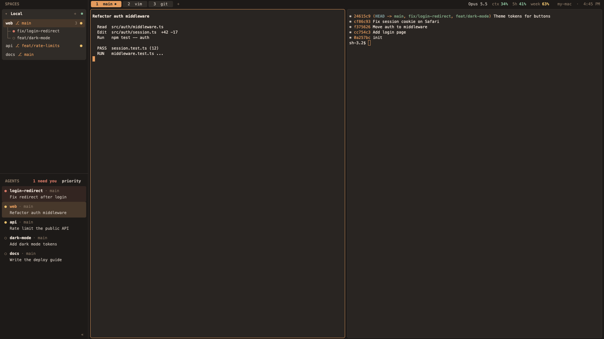

# herdr-tui-layout

herdr-tui's look and keys (the terminal herdr), inside herdr-app. A dark coffee-brown
window in Menlo 12.5: on the left, your spaces grouped by machine, each on one
line with its git branch and its worktrees on a little tree under it, and your
agents under them, with the focused agent's model and context, your Claude
5-hour and weekly use, and the machine and time on a line at the bottom. Over
the panes a 2px hairline in the border colour, divided once per tab of the
shown space, no text, the
shown tab's segment lit. Panes are rounded cards with a 1px border that turns
orange on the one you're typing in. `ctrl-b` drives it like herdr-tui does.
A community layout for herdr-app, not herdr-tui itself; not affiliated with Herdr.

## What you see

The theme is the person's own palette on warm grey surfaces
(`themes/herdr-tui-layout.json`): terminal `#242320` on `#e7e2d6`; bars and
sidebar `#1b1a17`; blocks, tabs and dialogs `#2d2b27`; hover `#3a3730`;
selected `#484439`; borders `#514d43`; accent `#afc8a6` (soft sage —
borders, tabs, branch names and cursor; mint `#35d6a4` stays the terminal
green); dim
text `#9a9484`. Status colours: working `#ffca5f`, needs you `#ff004c`,
done `#afc8a6`, idle `#9a9484`. Every font is Menlo at 12.5px, terminals and
panels alike; emphasis is bold or dim, never a bigger size.

Behind everything, the layout paints its background with
`backgrounds/herdr-tui-layout-bg.jpg`: the person's wallpaper (DotVibes
`appearance/bg.png`) **unmuted** — only format-converted, since Herdr
doesn't draw a PNG background — and pre-scaled 150% so the window maps to
the image's centre, not its transparent edges (`magick bg.png -resize
150% -background "#1b1a17" -flatten -quality 92 herdr-tui-layout-bg.jpg`).
Every surface mutes it itself: the terminals paint their own surface
a touch more transparent than stock (`terminal_opacity: 0.68` on the
root — measured at ~78% coverage against the raw wallpaper), the
sidebar's two cards carry the same base (`bg(t.background + "c7")` in
the mod), and
the tab bar's segments are opaque. The pane frames paint nothing, so the
image sits directly under the terminals only through the pane gaps. The
thin margins around the cards have no muting — they show the raw washes
where the image has content. The file's transparent areas flatten onto
this theme's chrome, so it belongs to this theme only.

Top to bottom:

1. **Sidebar, top half: spaces.** A rounded card with a 1px border,
   muting like the terminals — the card itself paints the terminal
   surface at ~78%. Inside, one panel per machine (transparent; the rows
   sit directly on the card's base),
   3px from the card's edges on every side and 6px between blocks.
   - The block's first row is the machine: `▾ Local` (this Mac) or its name,
     bold; `+` to start a space there; a 7px dot, green connected, yellow
     with `◐ reconnecting`, red with `unreachable`. Click the row to fold the
     machine to `▸`; folded, it shows the most urgent agent status inside it.
   - Then one line per space: its name (bold and on a `#484439` background
     when shown, cut at 150px), its branch in orange as `⎇ main` (or its
     folder, dim, when it has no branch and the folder isn't its name), and
     its tab count at the right when it has more than one tab.
   - A worktree space sits under its repo's space on a drawn tree: a 1px
     trunk and a 10px twig, the trunk stopping halfway on the last one, then
     a status mark and its branch. An orange `▾` at the right end of the
     repo's row folds them to `▸`.
   - Which repo: git, asked in each space's live folder (its first
     terminal's `cwd`, else its folder) every 15s: a space is a worktree when
     `--git-common-dir` isn't its `--show-toplevel`'s `.git`, and it nests
     under the space holding that repo's main checkout.
2. **Tab bar, a 2px hairline over the panes**, in the border colour so it
   meshes with the border lines around it, aligned with the cards' side
   edges (6px in from the window edge, 3px below the window's top
   edge). Divided once per tab of the shown space, no gaps and no text:
   the shown tab's segment is solid orange, the rest `#514d43`, and a
   hovered one lightens. Nothing shows when the space has no tabs. No `+`:
   new tabs come from `ctrl-b c` or the picker.
3. **Sidebar, bottom half: agents.** A draggable divider between the halves.
   - The same stacked sub-panel as the machines: one panel per half
     (transparent; the rows sit on the card's base, 3px from the card's
     edges) holding the rows, with its header inside — `AGENTS` with
     how many there are (or `2 need you` in red), and a `priority` /
     `spaces` switch.
   - One row per agent: `●` / `○` / `·` in its status colour, the space name
     bold, `· <tab name or number>` dim; under it, what the agent's terminal
     is titled (Claude's current task), muted. The agent you're in is on
     `#484439` with its name orange; one that needs you is tinted red.
   - **A status line at the bottom:** the focused agent's model (`Opus 5.5`),
     `ctx 11%`, `5h 12%`, `week 13%` (each number green, yellow from 50%, red
     from 80%; hovering 5h or week shows when it resets), then the machine
     the shown space runs on (this Mac's short hostname, or a remote
     machine's own hostname) and the time, `my-mac  ·  3:10 PM`, with `«` at
     the right to fold the sidebar.
4. **Folded sidebar, 40px.** Spaces as their number on their machine with a
   status mark (`1○ 2· 3●`), other machines opening with `▾2`, `▾3`; the
   shown space highlighted; agents below a line as their space's first
   letter with a mark; `»` at the bottom opens it again at its last width.
5. **Panes:** cards with 6px corners and 6px gaps, no header line, terminal
   padding 6×10. The card paints no fill of its own — the background image
   sits directly under the terminal — and the terminal paints its `#242320`
   surface at ~78% over it (`terminal_opacity: 0.68` on the root,
   measured), so the wallpaper's washes show through. The tab bar
   hairline sits 4px below the window's top and 5px above the cards; 3px
   at the window's bottom.
6. **Popups and dialogs** (right-click menus, rename, worktree, help)
   draw their own opaque `#2d2b27` box with 10px corners and a 1px
   border; the selected row is `#484439` and follows the pointer. The
   space picker is the exception: its box is the popover colour at ~78%,
   matching the panels.

## How it behaves

- **Agent status** comes from the agents themselves (Claude Code reports it):
  working is yellow, done green, needs you red, idle a ring. In `priority`
  order, agents needing you come first, then done, working, idle; in
  `spaces` order they follow the spaces list. `ctrl-b alt-1..9` jumps to the
  agent in that row.
- **Clicks:** a space switches to it; dragging a space onto another of the
  same machine moves it (it fades; an orange line shows where it lands);
  right-click a space for Rename, New / Open / Remove worktree, Close. A
  segment of the tab bar selects its tab; the bar is also the window's drag
  handle (the layout draws no title bar), so dragging it moves the window
  and a double-click maximizes. An agent row goes to that agent. Right-click
  a terminal for split, zoom, close. The sidebar's blocks drag the window
  too; its rows and buttons stop their presses, while the gaps, the machine
  rows and the status line still drag it.
- **Keys** (`keys.json`, only while this layout shows; prefix `ctrl-b`):
  `c` new tab, `n` / `p` next / previous, `shift-x` close tab,
  `shift-t` rename tab; `shift-1..9` space N, `up` / `down` previous /
  next space and `alt-j` / `alt-k` the same without the prefix — both walk
  the sidebar's order (worktrees right after their repo), wrapping at the
  ends — and `alt-h` / `alt-l` previous / next tab. `left` / `right` back
  / forward through your recent spaces (wrapping at the ends; a new jump
  drops the forward ones; closed spaces are skipped), `alt-left` /
  `alt-right` focus the pane to the left / right,
  `shift-n` new space, `r` or `shift-w` rename space, `shift-d` close
  space, `w` space picker (one row
  per space: name and agent status, worktrees nested under their repo's
  space; Enter or a click goes there),
  `shift-g` new
  worktree; `shift-h` / `shift-j` / `shift-k` / `shift-l` split left /
  down / up / right (left and up split right or down and swap, since
  pane.split only makes right/down), `x` close pane, `z` or `m` zoom,
  `h j k l` move between panes; `b` hide the sidebar, `shift-b` fold it
  to its strip and back; `shift-/` help; `s` settings;
  `alt-g` lazygit, `alt-b` btop, `alt-f` yazi, each in a floating terminal
  (80% / 90% of the window) that closes when the program exits.
- The status line's numbers refresh every 15s; machine states and hostnames
  every 10s and 60s; the clock every 15s.

## Built from

- **Layout** (`layouts/herdr-tui-layout.json`): a row (`titlebar: "none"`,
  `traffic_lights` `[14, 14]`, `terminal_menu: "herdr-tui-layout-menu"`,
  `background` the wallpaper image `backgrounds/herdr-tui-layout-bg.jpg`
  (`fit: "cover"`), `terminal_opacity: 0.68`):
  `sidebar` (column, 280px,
  40–480, gap 5, no padding — the mod draws the cards so the margins can
  differ per side: 4 at the top and bottom, 3 at the sides) holding
  `side-spaces` and `side-agents`
  (blocks, weight 1, min 80, both `window_drag`; both `herdr-tui-layout-side` with `props.part`
   `"spaces"` / `"agents"`), and `work` (column, resizable false so the
   hairline can't be stretched, padding `[3, 6]`, gap 3) holding
   `tabsbar` (block, 2px, `window_drag`, `herdr-tui-layout-tabs`) and
  `main` (block, no padding, `{ tab: "active" }` with pane frames: gap
  6, radius 6, no fill (the background paint shows through), border
  `border`, focus `accent`, `lone: true`, no header).
- **herdr-tui-layout-side:** `spaces()`, `agents()`, `machines()`, `panes()`,
  `setAgentOrder`, `space.select`, `space.move`, `space.new`, `pane.focus`,
  `layout.resize` (fold to 40, unfold to the width it had, kept in
  `localStorage`), `openOverlay`; polls `hc machine ls --json` for connection
  states, and its git probe is shared as `side.git` for the picker's
  worktree nesting; listens on `nextCommand()` for `agent-N`, `recent-back`,
   `recent-forward`, `space-next`, `space-prev`, `split-left`, `split-up`, `fold-toggle`, `rename-space`, `new-worktree` (spaces copy; the
   recents pair walk a back/forward list of spaces the mod tracks in
   `render()`, and the space pair walk `displayOrder` — each top space
   followed by its worktrees, per machine, rebuilt every render) and
   `picker`, `help`, `rename-tab`,
   `popup-lazygit|btop|yazi` (agents copy). The agents copy also runs the
   status chores: `hostname -s`, `hc machine ls --json` for hostnames, and
   a `sh` loop reading `~/.local/state/herdr-tui-layout/claude/*.json`;
   starts
  popups with `hc run --bg --rm` and shows them as dialog overlays holding
  the terminal, sized as shares of the window.
- **herdr-tui-layout-tabs:** `spaces()`, `tab.select`; one full-height
  segment per tab of the shown space, the active one `accent`, the rest
  `border`; its presses pass through, so the 2px hairline drags the window.
- **Copies of Herdr's mods** (Apache-2.0, see NOTICE), each opened with
  `frame: "none"` and drawing its own rounded box: `herdr-tui-layout-menu`
  (`menu`), `herdr-tui-layout-prompt` (`prompt`),
  `herdr-tui-layout-worktree` (`worktree`), `herdr-tui-layout-picker`
  (`picker`), `herdr-tui-layout-help` (`help`).
- **extras/claude-usage-hook.sh**, optional: a Claude Code `statusLine`
  command that saves each session's status JSON to
  `~/.local/state/herdr-tui-layout/claude/<session_id>.json` and prints nothing.
  Install it with `"statusLine": {"type": "command", "command":
  "<path>/claude-usage-hook.sh"}` in `~/.claude/settings.json`.

## Watch out

- **What it runs and reads:** `hostname`, `hc machine ls`, `git rev-parse` in each space's folder every 15s (to nest worktrees) and `git` in the worktree dialog, `sh`/`ls`/`stat` over `~/.local/state/herdr-tui-layout/claude/`,
  and lazygit/btop/yazi on their keys. No network.
- **Without the usage hook** the agents half's status line just leaves
  model, ctx, 5h and week out. The hook applies to every Claude Code session
  on the machine.
- **Two copies, one listener.** The side mod runs twice (`props.part`
  `"spaces"` / `"agents"`), and every `<mod>.<command>` key reaches both, so
  the loop checks its part before acting: the picker, help, rename-tab and
  popup keys only act on the agents copy, rename-space and new-worktree only
  on the spaces copy.
- **Square-in-rounded corners:** Herdr's own dialogs paint a square
  background inside the app's slightly rounded frame, and the corners show a
  notch. That's why five mods are copies opened with `frame: "none"`. The
  terminal right-click menu and the close-confirm dialog are opened by the
  app itself, which ignores that, so they keep Herdr's small corners;
  `popover` in the theme matches the frame so they stay clean.
- **Background images are JPGs, live on the root, and reload on a layout
  switch.** The same image as a PNG drew flat chrome; as a JPG it renders.
  Pane frames won't paint an image at all — given one, the frame falls
  back to the terminal background colour — which is why the file sits on
  the root and `terminal_opacity` does the muting. And replacing the file
  under the same name doesn't redraw — switch layouts away and back (or
  restart) before judging a new blend.
- **`herdr-app check` alone isn't enough:** it renders once without agents,
  so a bad style call in an agent row passes it. Type-check against the
  mod's `gpui-kit.d.ts` too (`line_clamp` doesn't exist; `flex_shrink()`
  needs a number), and look at the window: `line_height(15)` is fifteen
  times the text size, not 15px.
- **Saved drags beat the file:** a dragged boundary is kept in
  `layouts/.state/` and overrides `layouts/herdr-tui-layout.json`. A state
  saved by an older install may still carry a removed block's size; it's
  harmless when no block has that id.
- **Worktree nesting** asks git, never names: a space's `folder` can be
  stale (where it was made) and its name can be anything. An earlier build
  matched folder names and put one repo's worktree under another repo.
- **`ctrl-b`** is taken from programs while this layout shows (shells lose
  ctrl-b for back-a-character).
- Untested on screen so far: the `ctrl-b` keys, the popups, help and the
  reconnecting state; each loads and type-checks.

## Done when

- With the layout shown, the window has no title bar: the sidebar runs to
  the top, and over the panes sits the 6px tab bar, one segment per tab with
  the shown tab's lit.
- Spaces show grouped by machine on `#2d2b27` blocks, one line each, with
  worktrees on a drawn tree under their repo; clicking `▾ Local` folds it.
- Clicking a segment of the tab bar switches tabs; dragging the bar moves
  the window.
- Dragging a space onto another moves it.
- `«` folds the sidebar to a 40px strip of numbers and letters; `»` restores
  its width. Dragging the sidebar's empty space moves the window.
- `ctrl-b c` opens a tab; `ctrl-b alt-g` opens lazygit floating over the
  tab, gone when it quits.
- Right-click a space → Rename opens a dialog with 10px corners and no notch.
- With the usage hook installed and a Claude session running, the agents
  half's bottom line shows its model and ctx, and 5h and week turn yellow
  past 50%.
- Every mod passes `herdr-app check`, and a TypeScript check against its
  `gpui-kit.d.ts` shows no errors the mod's Herdr original doesn't have.
